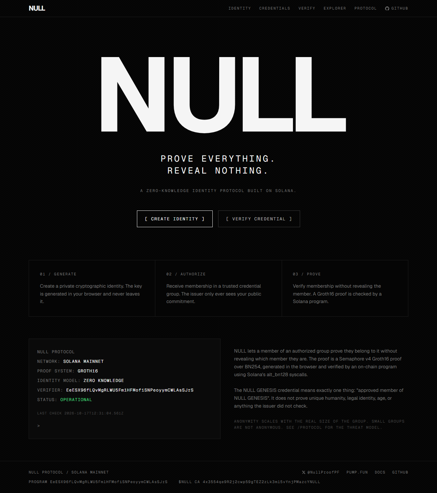
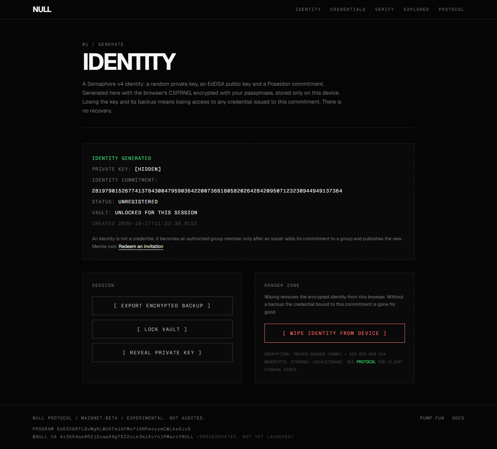
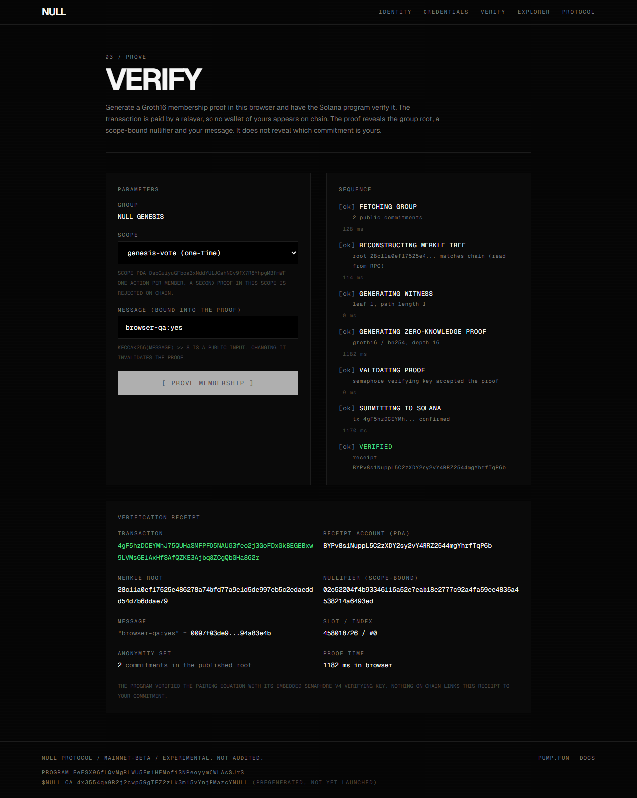
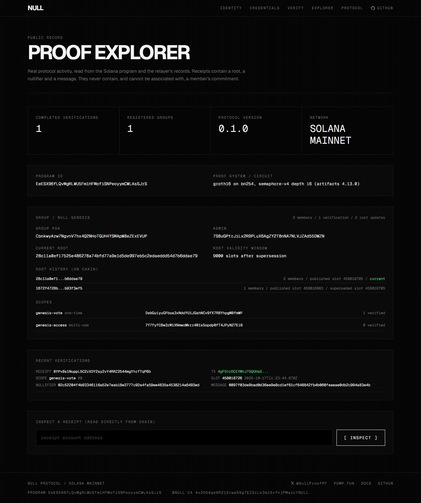
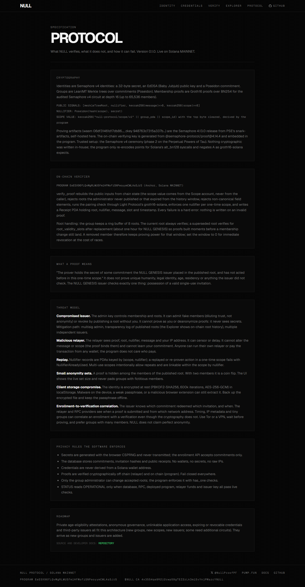

<div align="center">

<br />

# NULL

### PROVE EVERYTHING. REVEAL NOTHING.

**A zero-knowledge identity protocol on Solana.**
Prove you belong to a group without revealing which member you are.

<br />

[](https://nullproof.lol)
[](https://explorer.solana.com/address/EeESX96fLQvMgRLWU5Fm1HFMofiSNPeoyymCWLAsSJrS)
[](docs/ARTIFACTS.md)
[](https://semaphore.pse.dev)
[](https://github.com/NullproofPF/null/actions)
[](LICENSE)

<br />

[**Live app**](https://nullproof.lol) · [**Protocol spec**](https://nullproof.lol/protocol) · [**Proof Explorer**](https://nullproof.lol/explorer) · [**Program on Solana**](https://explorer.solana.com/address/EeESX96fLQvMgRLWU5Fm1HFMofiSNPeoyymCWLAsSJrS) · [**X @NullProofPF**](https://x.com/NullProofPF)

<br />



</div>

<br />

## What NULL is

NULL lets a member of an authorized group prove membership to a Solana program **without revealing which member they
are**, which wallet they use, or their identity secret. It is real cryptography end to end:

- **Identities** are [Semaphore v4](https://semaphore.pse.dev) identities, generated with the browser's CSPRNG and
  encrypted at rest with a passphrase. The private key never leaves the device.
- **Groups** are Poseidon Merkle trees (LeanIMT). An issuer admits public commitments and publishes the root on chain.
- **Proofs** are Groth16 proofs over BN254 from the audited Semaphore v4 circuit, generated in the browser with snarkjs in
  about one second.
- **Verification** happens on chain: an Anchor program checks the pairing equation through Solana's `alt_bn128`
  syscalls (Light Protocol's `groth16-solana`), enforces scope-bound nullifiers, and stores a public receipt.
- **A sponsored relayer** pays the transaction fee, so a prover never exposes a Solana wallet.

The result is a privacy verification layer other Solana applications can build on: anonymous one-member-one-vote,
unlinkable access gates, private community membership. Today it ships one credential, **NULL GENESIS**, which means
exactly "approved member of NULL GENESIS" and nothing else.

> **Status.** Live on Solana mainnet. Nothing in NULL holds or moves funds. Security policy and disclosure process:
> [SECURITY.md](SECURITY.md); guarantees and limits: [docs/THREAT_MODEL.md](docs/THREAT_MODEL.md).

<br />

## Table of contents

- [How it works](#how-it-works)
- [Screens](#screens)
- [Deployment on mainnet](#deployment-on-mainnet)
- [The on-chain program](#the-on-chain-program)
- [Privacy model, in one paragraph](#privacy-model-in-one-paragraph)
- [Repository layout](#repository-layout)
- [Development](#development)
- [Tests](#tests)
- [Test evidence from devnet](#test-evidence-from-devnet)
- [Documentation](#documentation)
- [Roadmap](#roadmap)
- [Token](#token)
- [Acknowledgements](#acknowledgements)
- [License](#license)

<br />

## How it works

```
 member's browser                      NULL backend (Next.js)                    Solana mainnet
 ────────────────                      ──────────────────────                    ──────────────
 1 CREATE IDENTITY                     issuer                                    null_verifier program
   Semaphore v4 identity               invitations (sha256 only)                 Group PDA      admin, current root,
   secret in WebCrypto vault,          commitments, Merkle root                                 ring buffer of 8 roots
   encrypted with passphrase           update_group_root (admin key) ─────────►  Scope PDA      scope_value (derived on
                                                                                                chain), one_time flag
 2 OBTAIN CREDENTIAL                   relayer
   redeem single-use code,             verifies proof off chain first,           NullifierRecord PDA   per scope
   submit commitment only ──────────►  previews nullifier, rate limits,          Receipt PDA    root, nullifier,
                                       pays verify_proof ───────────────────────►                message, slot
 3 PROVE MEMBERSHIP
   rebuild tree from public            explorer
   commitments, check root             receipts, roots, scopes, chain sync ◄────  anyone can read receipts
   against chain, snarkjs Groth16
   prove, verify locally, send
   PUBLIC DATA ONLY to relayer ──────► 
```

**Proof inputs.** Private: identity secret, Merkle path. Public, in exactly this order: `merkleTreeRoot`, `nullifier`,
`keccak256(message) >> 8`, `keccak256(scope) >> 8`. The nullifier is `Poseidon(hash(scope), secret)`: one per identity
per scope, unlinkable across scopes.

**Scopes.** A scope is an action ("vote on proposal 7", "enter the room"). The program derives the scope value from the
Scope account itself, never from the caller, so a prover cannot pick a convenient scope to dodge a one-time limit.

**Roots.** The issuer publishes a new root whenever membership changes. The program keeps the current root and a ring
buffer of 8 previous roots; a superseded root stays valid for `root_validity_slots` (about an hour for NULL GENESIS) so
in-flight proofs survive membership changes. Set it to 0 for immediate revocation.

<br />

## Screens

<table>
  <tr>
    <td width="50%"></td>
    <td width="50%"></td>
  </tr>
  <tr>
    <td align="center"><sub><b>/identity</b> · generated in the browser, private key hidden by default, encrypted backup export</sub></td>
    <td align="center"><sub><b>/verify</b> · every step is real; VERIFIED appears only after the program accepted the proof</sub></td>
  </tr>
  <tr>
    <td width="50%"></td>
    <td width="50%"></td>
  </tr>
  <tr>
    <td align="center"><sub><b>/explorer</b> · public record: roots, scopes, nullifiers, receipts, transaction signatures</sub></td>
    <td align="center"><sub><b>/protocol</b> · what is verified, what is not, and how it can fail</sub></td>
  </tr>
</table>

<br />

## Deployment on mainnet

Deployed 2026-10-17 from the same 183,304-byte binary that passed the full devnet suite
(sha256 `e2a50995776b415668b53410e4292240dce4188db6efea0f01f3092daa6e4a99`).

| | |
|---|---|
| Program | [`EeESX96fLQvMgRLWU5Fm1HFMofiSNPeoyymCWLAsSJrS`](https://explorer.solana.com/address/EeESX96fLQvMgRLWU5Fm1HFMofiSNPeoyymCWLAsSJrS) |
| Deploy transaction | [`4qBcs5qF...yNw6`](https://explorer.solana.com/tx/4qBcs5qF4LZUHb1t6ZcDFRB7BkUvR2P9ghXt4oUXqUdk8FvoiYxMexsvbCBQJVUtwTJXgjM2AqpaqMYan2DWyNw6) (slot 458016173) |
| Upgrade authority / issuer | `7S8uGPtrJiLx2R9PLuX6AgZY2T8nNA7NLVJZAd55DWZN` |
| Relayer | `A5JV8iecUWKgrB7YDzf5Pja5GDkAasVrNFrN4ETPD5y4` |
| NULL GENESIS group | [`CbnkwyAzw7NgvnV7hx4Q2NHoTGUH4YSMApW8eZExEVUP`](https://explorer.solana.com/address/CbnkwyAzw7NgvnV7hx4Q2NHoTGUH4YSMApW8eZExEVUP) |
| Scope `genesis-vote` (one-time) | `DsbGuiyuGFboa3xNddYU1JGahNCv9fX7R8YhpgMBfmWF` · [tx](https://explorer.solana.com/tx/57sPeGAAe6D91AbmPRA3T9dVeiBvtwQLiVcAKjoCaN7uVmerT8r4hPCNX8f3qXgHzY4oDN9UW6LkFQx8pRT8fQfG) |
| Scope `genesis-access` (multi-use) | `7Y7fyfC6w3rM1XNmwoWkrz4B1s5opdpBfT4JPyN27Ei6` · [tx](https://explorer.solana.com/tx/2kprdutG4ifGmLXfT7WPsWdS6d98gW6vwafniodh5EdYvnvKUBcWvv1u1hYYubEmwQoAMFuYFM4x9Mjvv7fVDHeC) |
| First root | [`4eCnTN23...1QLi`](https://explorer.solana.com/tx/4eCnTN23H6qde6CGYR5JqZrfNG8TP24Gif5fmxgKu38b8Rg7SdgjZR3gx4VmrFmZqMSCEKtTpK4TN5dNfo4G1QLi) |
| First verified proof (browser, 1.18 s) | [`4gF5hzDC...862r`](https://explorer.solana.com/tx/4gF5hzDCEYMhJ75QUHaSMFPFD5NAUG3feo2j3GoFDxGkBEGEBxw9LVMs6E1AxHfSAfQZKE3Ajbq8ZCgQbGHa862r) |
| Web | https://nullproof.lol (Next.js on Railway, Postgres for the issuer registry) |

The members enrolled during the mainnet smoke test are operator test identities whose keys were discarded; they are
revoked (`scripts/ops/revoke-member.ts`) as real members arrive, so the published member count stays honest. Public
mainnet RPC nodes refuse browser requests (HTTP 403), so the browser reads Group and Scope accounts from
`solana-rpc.publicnode.com` and labels the fallback if it has to use the NULL API instead.

<br />

## The on-chain program

`program/programs/null-verifier`, Anchor 0.32, built with `cargo build-sbf`, about 183 KB.

| Instruction | Who | What it enforces |
|---|---|---|
| `initialize_group` | anyone (becomes admin) | admin key, Merkle depth, root validity window, optional initial root |
| `update_group_root` | group admin | root is a field element and non-zero; previous root enters the ring buffer with its supersession slot |
| `set_root_validity` | group admin | how long superseded roots stay acceptable |
| `transfer_group_admin` | group admin | hand the group to a new key |
| `create_scope` | group admin | derives `scope_value = keccak(domain, group, scope_id)` on chain; one-time or multi-use |
| `verify_proof` | anyone (the relayer in practice) | see below |

`verify_proof` rebuilds the public inputs from chain state, then rejects in this order: malformed proof bytes,
non-canonical field elements, a root the admin never published or that expired from the history window, a scope that
belongs to another group, a wrong message binding, a consumed nullifier in a one-time scope, and finally an invalid
pairing. Only after all of that does it write a `NullifierRecord` and a `Receipt` (root, nullifier, message, slot,
timestamp). It consumes about 125k to 134k compute units.

Errors: `Unauthorized`, `UnknownRoot`, `StaleRoot`, `NullifierAlreadyUsed`, `ScopeGroupMismatch`,
`InvalidPublicInput`, `MalformedProof`, `InvalidProof`.

**Proof format.** Semaphore's packed points are converted to the 256-byte layout `groth16-solana` expects (big-endian
coordinates, G2 limbs in `(c1, c0)` order, `A` negated). The verifying key for depth 16 is generated from
`@semaphore-protocol/proof` by `scripts/gen-verifying-key.ts` into `verifying_key.rs`; every fixture proof is checked
against an independent noble-curves pairing oracle before it is trusted in tests. Details in
[docs/ARTIFACTS.md](docs/ARTIFACTS.md).

<br />

## Privacy model, in one paragraph

A receipt shows a root, a nullifier and a message. Nothing on chain links it to a commitment, and the relayer only ever
sees public proof data. What NULL does **not** hide: the issuer knows which commitment redeemed which invitation and
when; the relayer and RPC see request timing and network metadata; and the anonymity set is exactly the number of real
members in the current root, never padded. With a small group and tight timing, someone who controls issuer and relayer
logs can correlate an enrollment with a verification without breaking any cryptography. The full analysis, including
compromised issuer, malicious relayer, replay, client storage compromise and upgrade authority, is in
[docs/THREAT_MODEL.md](docs/THREAT_MODEL.md).

<br />

## Repository layout

```
program/programs/null-verifier   Anchor program (Rust) + generated verifying_key.rs
program/tests                    LiteSVM integration tests (17), run against the compiled .so
program/tests/fixtures           Real Semaphore proofs + hash vectors shared by Rust and TS tests
src/lib/zk                       Field encoding, Semaphore hashing, proof -> Solana byte layout
src/lib/solana/program.ts        Hand-encoded client: PDAs, discriminators, instructions, decoders
src/lib/server                   env, Postgres, issuer, relayer, explorer, health
src/lib/identity                 Browser vault (WebCrypto: PBKDF2-SHA256 600k, AES-256-GCM)
src/lib/client                   API client and the browser proving pipeline
src/app                          Pages: /, /identity, /credentials, /verify, /explorer, /admin, /protocol
src/app/api                      Route handlers (docs/API.md)
scripts                          gen-verifying-key, gen-fixtures, demo-e2e, ops (reset registry, revoke member)
tools                            Railway helpers, admin CLI, key import, headless browser QA
worker                           Cloudflare Worker bridge used while DNS pointed at the proxy
docs                             THREAT_MODEL, ARTIFACTS, DEPLOYMENT, API, screenshots
public/artifacts                 semaphore-16.wasm / .zkey (self-hosted proving artifacts, hashes in docs/ARTIFACTS.md)
```

<br />

## Development

Requirements: Node 22+, Rust 1.8x, Agave CLI 2.x+ (`cargo-build-sbf`), a Postgres URL. No Anchor CLI is needed; the
program is built with `cargo build-sbf` and tested in-process with LiteSVM.

```bash
npm install
cp .env.example .env.local        # DATABASE_URL, keys, ADMIN_TOKEN (see docs/DEPLOYMENT.md)
npm run vk                        # regenerate verifying_key.rs from @semaphore-protocol/proof, then cargo fmt
npm run fixtures                  # real proofs for both test suites, cross-checked with a pairing oracle
npm run program:build             # cargo build-sbf -> program/target/deploy/null_verifier.so
npm run program:test              # 17 LiteSVM tests
npm test                          # 15 TypeScript unit tests
npm run typecheck && npm run lint
npm run dev                       # http://localhost:3000
```

Operator commands against a deployment (bearer token from `.env.local`, host from `.domain.txt`):

```bash
node tools/admin-cli.mjs group null-genesis NULL GENESIS    # initialize_group on chain + registry row
node tools/admin-cli.mjs scope genesis-vote                 # one-time scope
node tools/admin-cli.mjs scope genesis-access --multi       # multi-use scope
node tools/admin-cli.mjs invites 5 friends                  # single-use codes, shown once, stored as sha256
node tools/admin-cli.mjs publish-root                       # after members enrolled
node tools/qa-browser.mjs https://<host> NULL-XXXXX-XXXXX-XXXXX   # headless Chromium: identity -> enroll -> root -> prove
```

The same actions are available at `/admin` with the bearer token. Deployment to Solana, Railway and a custom domain is
documented step by step in [docs/DEPLOYMENT.md](docs/DEPLOYMENT.md).

<br />

## Tests

| Suite | What it covers |
|---|---|
| `program/tests` (LiteSVM, 17 tests) | happy path with receipt inspection; exact replay and fresh re-proof in a one-time scope; second member in the same scope; new scope allowed; multi-use counting; tampered proof; all-zero proof; wrong message; wrong scope; forged root; unauthorized admin on every admin instruction; superseded root expiry and zero validity; scope from another group; non-field public inputs; admin transfer |
| `tests/unit` (Vitest, 15 tests) | field encoding; Semaphore hashing against fixture vectors; scope derivation parity with the program; proof byte layout parity with proofs the SVM accepted; PDA parity; instruction layout |
| `scripts/gen-fixtures.ts` | every fixture proof is verified by Semaphore's verifier and by an independent noble-curves pairing check that parses the Solana byte layout |
| `scripts/demo-e2e.ts` | devnet end-to-end demonstration through the real issuer and relayer code, positive and negative cases; refuses to run against mainnet because it enrolls throwaway identities |
| `tools/qa-browser.mjs` | headless Chromium run of the real UI against a live deployment: 9/9 on devnet and 9/9 on mainnet |

CI runs typecheck, lint, the unit tests, `cargo fmt --check` and clippy on every push.

<br />

## Test evidence from devnet

The same program id was first deployed to devnet with a separate test key and exercised end to end before mainnet. These
are devnet transactions (`?cluster=devnet`); the full log is in `artifacts/devnet-evidence.json`.

Program deploy: [`5GyvWZUK...AhC3`](https://explorer.solana.com/tx/5GyvWZUKC5a9ZZHUycyic869ESYXEoDLHGCcdfpZDDfgrz8eKdJ6TeAjYakADjHENFXZHUkZZkpiVtdsiTQKAhC3?cluster=devnet), slot 512041248.

| Step | Result | Transaction |
|---|---|---|
| Administrator creates NULL GENESIS | group PDA `CbnkwyAz...EVUP` | |
| Scopes `genesis-vote` (one-time) and `genesis-access` (multi-use) | created | |
| Alice and Bob enroll with single-use codes | leaves 0 and 1; code reuse and unknown code rejected | |
| Administrator publishes root | 2 members | [`4xM322yj...JRr1N`](https://explorer.solana.com/tx/4xM322yjnowtjWHB7eFgZZTajygYMeawQQZ7L4jLtTKNUb69BToU4893qK2suH3GmA2bh4wis4723R7QTN9JRr1N?cluster=devnet) |
| Alice proves membership (genesis-vote) | verified on chain, receipt `BYPv8s1N...qP6b` | [`26rqkWWM...M3ML`](https://explorer.solana.com/tx/26rqkWWMLtoSWqbnfHvYwZkgLywnkCkHweTZdrm1nTjEpy6gPkLe5oJtDSXVVTUkAMJt4qH6Qbif9TfLNF59M3ML?cluster=devnet) |
| Replay of the same proof | rejected: nullifier already consumed | |
| Fresh proof, same identity, same one-time scope | rejected: nullifier already consumed | |
| Bob proves in the same scope | verified, distinct nullifier | [`2n2E2kJQ...Lu4vC`](https://explorer.solana.com/tx/2n2E2kJQaikXqDPLgaa93oSaxQLXdr14XBXpEsrQVWxSaFNMFp2QT847697R5GKyAawPQeCpfRPcmvPsLKTLu4vC?cluster=devnet) |
| Alice acts in a new scope (genesis-access) | verified, new nullifier | [`ivArYMBk...Ud5j`](https://explorer.solana.com/tx/ivArYMBkwigWRK1qE9mKdfoG21aZa5R4FxuLNvwtbAMHREm9bic3T7g4euNZEduzn8qc6LNqi34bMnQjFiAUd5j?cluster=devnet) |
| Alice repeats in the multi-use scope | verified, counted | [`KuWfHCkJ...SeRUp`](https://explorer.solana.com/tx/KuWfHCkJHL7e9jrbDFHtBPcvw721U2Ei4EC7voN2MwLvAmnFsczrCTJA4Y7A1t5eeDQrDGyxbY8SVn7LnKSeRUp?cluster=devnet) |
| Nonmember (Carol) | cannot build a Merkle proof for the published tree | |
| Carol with a forged tree | valid proof, unpublished root: rejected | |
| Tampered proof | rejected by the relayer's off-chain check | |
| Mismatched proof sent straight to the program | `InvalidProof (6007)`, 125,705 CU consumed, nothing written | |

With the public data alone, Alice's and Bob's receipts are indistinguishable.

<br />

## Documentation

| Document | Contents |
|---|---|
| [docs/THREAT_MODEL.md](docs/THREAT_MODEL.md) | parties, guarantees, non-guarantees, attacks considered, root lifecycle, open problems |
| [docs/ARTIFACTS.md](docs/ARTIFACTS.md) | Semaphore circuit version, artifact hashes, verifying key provenance, trusted setup assumptions |
| [docs/DEPLOYMENT.md](docs/DEPLOYMENT.md) | program deploy, keys, Railway, issuer bootstrap, custom domain, operations |
| [docs/API.md](docs/API.md) | every HTTP endpoint with request and response shapes |
| [SECURITY.md](SECURITY.md) | how to report a vulnerability, scope, upgrade authority |
| [nullproof.lol/protocol](https://nullproof.lol/protocol) | the spec as rendered on the live site |

<br />

## Roadmap

Architected for, not shipped yet: expiring and revocable credentials, multiple independent issuers, private
age-eligibility attestations, anonymous governance, unlinkable access to third-party applications, a verification API
for other Solana programs (CPI into `verify_proof`), verifiable builds, and moving the upgrade authority to a multisig
with a timelock.

<br />

## Token

$NULL launches separately on pump.fun. The token is **not required** for anything in this repository: creating an
identity, obtaining the NULL GENESIS credential and proving membership are free apart from the relayer's network fees,
which the project pays. Contract address and links are configuration (`NEXT_PUBLIC_TOKEN_CA`, `NEXT_PUBLIC_PUMP_URL`,
`NEXT_PUBLIC_X_URL`) rendered in the site footer; nothing in the code launches, mints or trades a token.

<br />

## Acknowledgements

[Semaphore](https://semaphore.pse.dev) by PSE for the circuit, identities and artifacts ·
[Light Protocol](https://github.com/Lightprotocol/groth16-solana) for `groth16-solana` ·
[snarkjs](https://github.com/iden3/snarkjs) and [circom](https://github.com/iden3/circom) by iden3 ·
[LiteSVM](https://github.com/LiteSVM/litesvm) for fast in-process program tests ·
[noble-curves](https://github.com/paulmillr/noble-curves) for the independent pairing oracle.

## License

[MIT](LICENSE). Security policy: [SECURITY.md](SECURITY.md).
